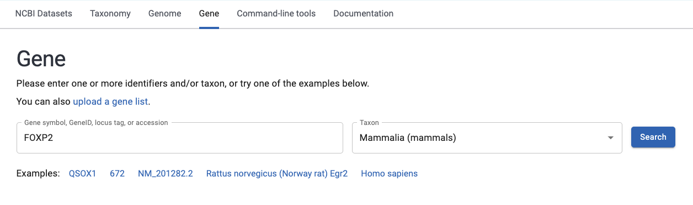
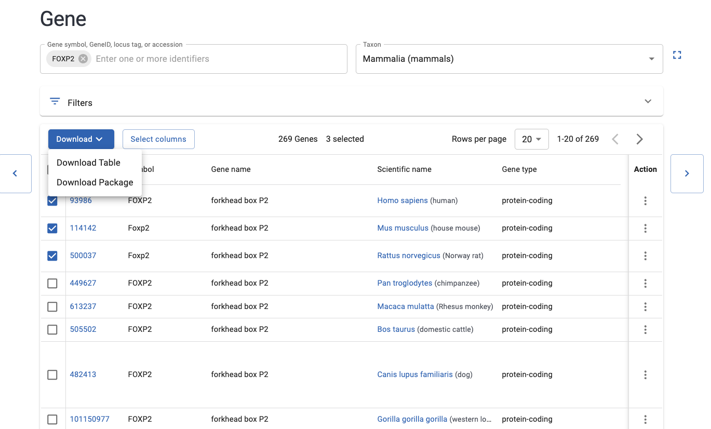
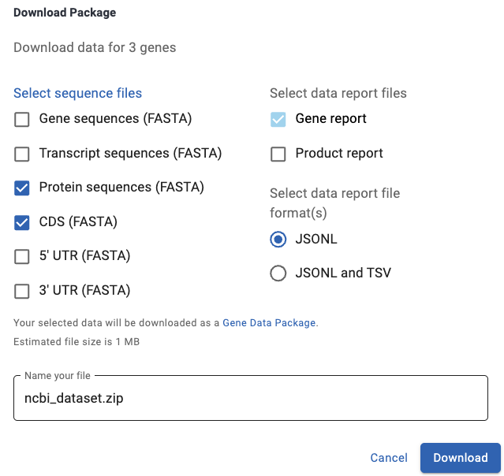

# Tutorial 3 - Downloading genomic sequences

## 1. What do genomic sequences look like on my computer?

A genomic sequence is any sequence that has been extracted from a genome.
🐞 It could be a gene, a protein, or a non-coding element (like a regulatory region).

These sequences are often saved as text files in different formats. One of the most common formats for evolutionary analyses is **FASTA**.

!!! info "FASTA format"
    A FASTA file is made up of two elements:

    * **Header:** A line at the beginning of a sequence that tells you about it. The header starts with `>` followed by descriptive text.
    * **Sequence:** The nucleotides or amino acids that make up the gene, protein, or non-coding element. The sequence starts on the line immediately below the header and is usually wrapped every 60–80 characters.

    ```text
    >XM_019925131.2:314-2584 PREDICTED: Tursiops truncatus forkhead box P2 (FOXP2), mRNA
    ATGATGCAGGAATCTGCGACAGAGACAATAAGCAACAGTTCAATGAATCAAAATGGAATGAGCACTCTAA
    GCAGCCAATTAGATGCTGGCAGCAGAGATGGAAGATCAAGTGGTGACACCAGCTCTGAAGTAAGCACAGT
    ```

## 2. Downloading genomic sequences

In our tutorials, we will analyze the coding sequences of the **FOXP2 gene**.

* Our goal is to investigate how FOXP2 evolved in mammals that are capable of vocal learning (like us!).
* First, we need to obtain **our data set**: a collection of FOXP2 sequences for different mammal species.
* We will download these sequences from **[NCBI](https://www.ncbi.nlm.nih.gov/)**, one of the most widely used genomic databases.

!!!info "There are two main ways to download these sequences from NCBI:"    

    * Use the graphical interface on the NCBI website.
    * Use the command line in your terminal.

We will start with the graphical interface. Then, we will learn about the command-line version, which is **essential** if you are interested in working with coding sequences.

!!!warning "The NCBI website is always changing, so it might look slightly different from the tutorial's images."

### 🍄 Downloading sequences from NCBI Nucleotide   

1. Go to the [NCBI Datasets Gene](https://www.ncbi.nlm.nih.gov/datasets/gene/) page.

2. On the search bar, type `FOXP2` under Gene symbol and select `Mammalia` under Taxon, then hit Search.

    { width="600" }

3. Select 10 species you want to download by clicking the empty box beside each name.      
**Which species to select?** Any one is ok, we are just practicing!

4. Select Download, then click on Download package.
    { width="600" }

5. A Download package window will pop up. Make sure that **CDS (FASTA)** and **Protein sequences (FASTA)** are selected. These two options will give you the coding sequences and proteins for the gene.    
Hit Download.

    { width="500" }

6. On your downloads, look for a folder called `ncbi_dataset.zip`; click it to unzip.   
    - This folder has the following structure: `ncbi_dataset > ncbi_dataset > data` (yes, two folders with the same name). Click through the folders until you reach `data`.  
    - Inside data, you will find 2 files: `cds.faa` and `protein.faa`. Save these files in your `tutorial_3` folder.

### 🍄 Pause for a deep breath

Brace yourself and take a deep breath. Things will get a little more complicated, but it's nothing you can't master with practice!

{ width="300" }

### 🍄 Downloading sequences using command-line

We will now learn how to download genomic sequences using the command line.
This is a useful way to download a set of **coding sequences**, which you can analyze with codon models such as **codeml**.

This part of the tutorial was adapted from NCBI's own tutorial: [Get one protein per gene from a set of orthologs](https://www.ncbi.nlm.nih.gov/datasets/docs/v2/tutorials/ortholog-get-one-isoform/). Feel free to check it out for more details!

!!! note "Why choose one transcript per gene?"
    Many genes undergo alternative splicing and have multiple transcript variants (mRNA isoforms). These transcripts come from the same gene, but their coding sequences and lengths can differ.

    Many comparative genomic studies use one sequence per gene. A common approach is to select the longest transcript, although the longest transcript is not necessarily the best representative of the complete coding sequence in every case.

??? info "For Awarnach server users"
    Access our lab server, Awarnach. For a reminder, see [Tutorial 2](tutorial_2.md).

    Activate the environment where `ncbi_datasets` is installed:

    ```sh
    source activate ncbi_datasets
    ```

1. Download the `ncbi-datasets` command-line tool from NCBI using conda:

    ```sh
    conda install -c conda-forge ncbi-datasets-cli
    ```

    If that doesn't work, you can find alternative ways [here](https://www.ncbi.nlm.nih.gov/datasets/docs/v2/download-and-install/).     

2. Navigate to your `tutorial_3` folder using `cd` followed by the path to the folder:

    ```sh
    cd tutorials_2026/tutorial_3/
    ```

3. We will now download the longest FOXP2 transcript for each species. For the steps below, copy and paste the commands into your terminal and press `Enter`.   
**Don't forget** to read each command to understand what it does!

🐛 This part can be challenging for beginners, so each completed step unlocks a celebratory cat GIF.  
**You got this!**

{ width="300" }

#### **🐞 Getting FOXP2 metadata**

We will use the `datasets summary` command to retrieve metadata about our FOXP2 sequences.  

!!! info "What is metadata?"
    Metadata is information that provides context about the data. For NCBI sequences, it can include:

    * Common gene name
    * Gene ID (an identifier unique to each gene)
    * Species or taxon name
    * Sequence accession number
    * Sequence length

We can donwload the metadata in two ways: by providing the **gene name** OR the **accession numbers** (a unique record number) of the sequences we want to download.  

**1. By gene name**    
We are going to use the command below to get every record of FOXP2 for humans and other mammals.
Note how the command is built:

- First, we say we want the summary - which is a data report - and we specify FOXP2 as our target gene with `gene symbol`
- Then, we pass 4 options into the command:
    - `taxon`: the species we want as our reference. 9606 is human (it's safer to use numbers rather than names here)
    - `ortholog`: the group for which we will download FOXP2 orthologs (same gene for different species), based on our reference species. 40674 is Mammals
    - `report product`: the type of report we want. In this case, we want the product, which contains the transcript information we need.
    - `as-json-lines`: the format we want our report in (has to be json because of the next command)
- What about the backslash (`\`)? That means a line break - it allows us to write in many lines without breaking the command.


```sh
datasets summary gene symbol FOXP2 \
    --taxon 9606 \
    --ortholog 40674 \
    --report product \
    --as-json-lines > foxp2_orthologs.jsonl
```


**2. By accession number**  
Another way is to download sequences by accession number. This is useful if you already have a list of species you want to download and know their accession numbers from NCBI, for example:

* Human (_Homo sapiens_) | NM_014491.4
* Chimpanzee (_Pan troglodytes_) | XM_063813769.1
* Cow (_Bos taurus_) | NM_001205569.3
* Bottlenose dolphin (_Tursiops truncatus_) | XM_019925131.2
* Killer whale (_Orcinus orca_) | XM_049715204.1
* Harbor seal (_Phoca vitulina_) | XM_032401732.1
* Dog (_Canis lupus familiaris_) | XM_038439870.1
* Little brown bat (_Myotis lucifugus_) | XM_023760067.1
* African elephant (_Loxodonta africana_) | XM_023544567.1
* Manatee (_Trichechus manatus latirostris_) | XM_004382567.2

Let's download the sequences for these species:

```sh
    datasets summary gene accession \
    NM_014491.4 XM_063813769.1 NM_001205569.3 XM_019925131.2 XM_049715204.1 XM_032401732.1 XM_038439870.1 XM_023760067.1 XM_023544567.1 XM_004382567.2 \
    --report product --as-json-lines > foxp2_orthologs2.jsonl
```

??? success "Well done! Click to unlock celebratory cat #1"

    { width="200" }

#### **🐞 Extracting information about sequence length**

We will use the `dataformat` command to extract the [Gene Product Report](https://www.ncbi.nlm.nih.gov/datasets/docs/v2/reference-docs/data-reports/gene-product/) from our JSON Lines file and convert it into a readable table in TSV format.
This report contains information about FOXP2 transcripts and proteins.
The `--fields` option specifies which information to include in the table, such as gene ID, symbol, and transcript length.

```sh
dataformat tsv gene-product \
--inputfile foxp2_orthologs.jsonl \
--fields gene-id,tax-name,symbol,transcript-accession,transcript-length,transcript-protein-accession,transcript-protein-length > transcript_protein.tsv
```

Let's take a look at this table using `head`, which displays the first 10 lines of a file. It's useful for taking a quick look at long files.

```sh
head transcript_protein.tsv
```

The beginning of your table should look like this:

```text
NCBI GeneID	Taxonomic Name	Symbol	Transcript Accession	Transcript Length	Transcript Protein Accession	Transcript Protein Length
93986	Homo sapiens	FOXP2	NR_033766.2	6355		
93986	Homo sapiens	FOXP2	NR_033767.2	6601		
93986	Homo sapiens	FOXP2	NM_148898.4	6618	NP_683696.2	740
93986	Homo sapiens	FOXP2	NM_148900.4	6594	NP_683698.2	732
93986	Homo sapiens	FOXP2	NM_014491.4	6543	NP_055306.1	715
93986	Homo sapiens	FOXP2	NM_001172766.3	6540	NP_001166237.1	714
93986	Homo sapiens	FOXP2	NM_001172767.2	1485	NP_001166238.1	457
93986	Homo sapiens	FOXP2	NM_148899.3	1410	NP_683697.2	432
449627	Pan troglodytes	FOXP2	XM_063813769.1	4716	XP_063669839.1	764
```

📍 Let's break down this table:

* The first line contains the column headers: gene ID, taxonomic name, symbol, transcript accession, transcript length, protein accession, and protein length.
* The columns are separated by tabs, so the table has seven columns.
* The first column contains the gene ID, the second the taxon name, and the third the gene name (the "symbol").
* Can you find the column with transcript accession numbers? What about protein length?

??? success "Great work! Click to unlock celebratory cat #2"

    { width="300" }

#### **🐞 Making a list of the longest sequences**

Now we will use a Bash script to locate the longest FOXP2 transcript and corresponding protein for each species and save their accession numbers in a list. The accession numbers will let us identify these sequences and download them later.

📍 Since this is a large script, it's safer to save it as a file and then run it. Create a new file:

```bash
nano list_longest.sh
```

Once your text editor is open, copy the script below and paste it into the editor using `Ctrl+V`.
Don't be scared! The comments starting with `#` explain what each part of the script does.

```bash
# Removes the first line (header) from the file and passes the rest to the next command
tail -n +2 transcript_protein.tsv | \
# Extracts the first column (gene IDs)
cut -f1 | \
# Sorts gene IDs alphabetically and removes duplicates
sort -u | \
# Reads each unique gene ID one by one
while read GENE_IDS; do

        # Searches for lines where the first column matches the gene ID
        LONGEST=$(grep -w "^$GENE_IDS" transcript_protein.tsv | \
        # Sorts the filtered lines numerically (-n), in descending order (-r), based on column 7 (protein length)
        sort -t$'\t' -nr -k7 | \
        # Selects the top row (the transcript with the longest protein sequence)
        head -n1 | \
        # Extracts column 4 (transcript ID) and column 6 (protein ID)
        cut -f4,6 | \
        # Converts the tab-separated values into newline-separated values
        tr '\t' '\n');

        # Appends the transcript ID and protein ID of the longest transcript to longest.list
        printf "$LONGEST\n" >> longest.list;

done
```

Now run the script by entering `bash list_longest.sh`. This tells the terminal to interpret the file using Bash.

📍 After it runs successfully, your script should have created a file named `longest.list`. Let's take a look:

```bash
cat longest.list
```

You should see on your screen the accession numbers of the longest transcripts and proteins, like this:

```text
XM_023544567.1
XP_023400335.1
XM_049715208.1
XP_049571165.1
XM_019925131.2
XP_019780690.1
XM_004382567.2
XP_004382624.1
XM_023760067.1
XP_023615835.1
XM_032401732.1
XP_032257623.1
XM_063813769.1
XP_063669839.1
XM_038687039.1
XP_038542967.1
XM_015469121.3
XP_015324607.1
NM_148898.4
NP_683696.2
```

??? success "Almost there! Click to unlock celebratory cat #3"

    { width="300" }

#### **🐞 Downloading the longest sequences**

Finally, it's time to download the selected transcripts (your data set)!
We will use the `datasets download` command to download the sequences from NCBI.

```bash
datasets download gene accession \
--inputfile longest.list \
--fasta-filter-file longest.list \
--include rna,cds,protein \
--filename longest.zip
```

After running this command, you should see output similar to this:

```text
Collecting 10 gene records [================================================] 100% 10/10
Downloading: longest.zip    33.5kB valid zip structure -- files not checked
Validating package [================================================] 100% 7/7
```
If the progress bar reaches 100%, the download was successful. The result is a ZIP file called `longest.zip`.

📍 Now let's look at the downloaded sequences by unzipping `longest.zip`:

```sh
unzip longest.zip
```

After entering the command, you should see output similar to this:

```text
Archive:  longest.zip
  inflating: README.md
  inflating: ncbi_dataset/data/rna.fna
  inflating: ncbi_dataset/data/cds.fna
  inflating: ncbi_dataset/data/protein.faa
  inflating: ncbi_dataset/data/data_report.jsonl
  inflating: ncbi_dataset/data/dataset_catalog.json
  inflating: md5sum.txt
```

Now, if you list (`ls`) what's inside your current folder, you will notice a new folder called `ncbi_dataset`. Let's see what's inside:

```bash
ls ncbi_dataset
```

Inside `ncbi_dataset` there's a folder called `data`. To see what's inside `data`, use `ls` again, followed by the path to `data`:

```bash
ls ncbi_dataset/data
```

You should see the following files: `cds.fna  data_report.jsonl  dataset_catalog.json  protein.faa  rna.fna`

{ width="400" }

**🌺 And there's our data!**

The sequence data of the FOXP2 gene is contained in 3 files:

* `rna.fna` contains the selected transcripts.
* `protein.faa` contains the corresponding protein sequences.
* `cds.fna` (which will be important in the next tutorials) contains the coding sequences.

Using `head`, take a look at the first lines of these three files.
**But watch out!** You are inside `tutorial_3`, and the files are in `ncbi_dataset/data`. There are two ways to run the command:

* Navigate to `data`, then use `head`:

  ```sh
  cd ncbi_dataset/data
  head rna.fna
  ```

* Run `head` from your current directory and provide the path to the input file:

  ```sh
  head ncbi_dataset/data/rna.fna
  ```

Choose whichever way you prefer, and do this for all three files. The first lines of `rna.fna` should look like this:

```text
>XM_015469121.3 FOXP2 [organism=Bos taurus] [GeneID=505502] [transcript=X1]
GGACCTGGCAGAGTCCCCACGGACGAGAGCGGGACTCGGGCGCTGGAGGCTGGGCCCGCGCACTCCCCAC
GCCGGCGTCTCGGCTTTGAAGTGCGAGCGGCAGTTCTGGCAGTTTCTTCTTTCCTTTCATTCCGGTTACT
TTGCTCCCCTCAGTCACTGACAGGCCCGTCTCGAGAGCCTCAGACCCCCAAAGTCTCAGCTCGGCAACCC
CTTCCTTCTAAGCTCCGCCCCGGCCGAACCGCAGCCCGGCGCCGAGCCGGTGACCAGGGCTGGGGGATCA
CGAGGAAGCCCGAGAACTCCCGGGTCCAAGTGAGACAGGAGCCCGACAACAATGAAGAGTGAGAAAGACA
CTCGGCCTCTCCACCCCAGGCCGCAGAGGCGCACACCGCGAAAAGAAAGGCCAGTCAGCGTTTTAACGCA
CGCTTGGGTCTCCCTTTCTGACTCTCGAGTACTTTAACTCCTTGCCACCGAGGGCTTTGGATCCCTTCGA
GGCTTCCTGCACTTCACTTGGAATTCCCTGTTTCATTTGCCAGCAGCTCCGTCTGCTGAGAGGACGTACT
TTAGGGACTGCCAAGAAGCAGCAGACACAACTCAGCTTTGCCAATACAGCATAAGGTTTTGTTCTCTCCT
```
The first lines of `protein.faa` should look like this:

```text
>XP_015324607.1 FOXP2 [organism=Bos taurus] [GeneID=505502] [isoform=X1]
MMQESATETISNSSMNQNGMSTLSSQLDAGSRDGRSSGDTSSEVSTVELLHLQQQQALQAARQLLLQQQT
SGLKSPKSSDKQRPLQELLPETKLCVCGHSSGDGHPHNTFAVPVSVAMMTPQVITPQQMQQILQQQVLSP
QQLQALLQQQQAVMLQQQQLQEFYKKQQEQLHLQLLQQQQQQQQQQQQQQQQQQQQQQQQQQQQQQQQQP
QQQHPGKQAKEVGSGQLIHAEEREQQQQQLAAQQLVFQQQLLQMQQLQQQQHLLSLQRQGLISIPPGQAA
LPVQSLPQAGLSPAEIQQLWKEVTGVHSMEDNGIKHGGLDLTTNNSSSTTSSTTSKASPPITHHTIVNGQ
SSVLNARRDSSSHEETGASHTLYGHGVCKWPGCESICEDFGQFLKHLNNEHALDDRSTAQCRVQMQVVQQ
LEIQLSKERERLQAMMTHLHMRPSEPKPSPKPLNLVSSVTMSKNMLETSPQSLPQTPTTPTAPVTPITQG
PSVITPASVPNVGAIRRRHSDKYNIPMSSEIAPNYEFYKNADVRPPFTYATLIRQAIMESSDRQLTLNEI
YSWFTRTFAYFRRNAATWKNAVRHNLSLHKCFVRVENVKGAVWTVDEVEYQKRRSQKITGSPTLVKNIPT
```
The first lines of `cds.fna` should look like this:

```text
ATGATGCAGGAATCTGCGACAGAGACAATAAGCAACAGTTCAATGAATCAAAATGGAATGAGCACTCTAA
GCAGCCAATTAGATGCTGGCAGCAGAGATGGAAGATCAAGTGGTGACACCAGCTCGGAAGTAAGCACAGT
AGAACTGCTGCATCTGCAACAACAGCAGGCTCTCCAAGCAGCGAGACAACTTCTCTTACAGCAGCAAACA
AGTGGATTGAAATCTCCTAAGAGCAGTGATAAACAGAGACCACTGCAGGAATTGCTTCCAGAAACAAAAT
TATGTGTCTGTGGCCACTCTTCTGGTGATGGGCATCCTCACAACACATTTGCAGTGCCCGTGTCAGTGGC
CATGATGACTCCCCAGGTGATCACCCCTCAGCAAATGCAGCAGATCCTTCAGCAGCAAGTCCTGTCTCCT
CAGCAGCTCCAAGCCCTCCTTCAGCAGCAGCAGGCAGTCATGCTGCAGCAGTCAAAATGGTTTATTCAGC
AACAACTACAAGAGTTTTACAAGAAACAGCAAGAGCAGTTACATCTTCAGCTTTTGCAGCAGCAGCAACA
GCAGCAGCAGCAGCAGCAGCAGCAGCAACAGCAGCAGCAGCAGCAGCAGCAGCAACAGCAGCAGCAGCCC
```

**Do these sequences remind you of the `fasta` format we talked about at the beginning?**

Well, there you go! You have just downloaded your first genomic sequences in `fasta` format. 🌺

**Do you notice any differences between these three sequences? How are they different?**

## 3. Preparing sequences for analysis

### 🍄 Editing the headers of a fasta file

The FASTA headers contain several fields. This command creates shorter headers from the gene name, organism, and transcript information, while leaving the sequence lines unchanged. It writes the result to `cds_headers.fna`.

```sh
awk -F' ' '
/^>/ {
    gene = $2                          # Extract second field (FOXP2)
    sub(/\[organism=/, "", $3)         # Remove "[organism=" from third field
    org = substr($3, 1, 1)             # Take the first letter (C)
    sub(/\]/, "", $4)                  # Remove closing bracket if present
    ending = substr($4, 1, 3)          # Take first three letters (lup)
    print ">" gene "_" org ending      # Output formatted header
    next                               # Skip further processing for header lines
}
{print}  # Print sequence lines unchanged
' cds.fna > cds_headers.fna
```